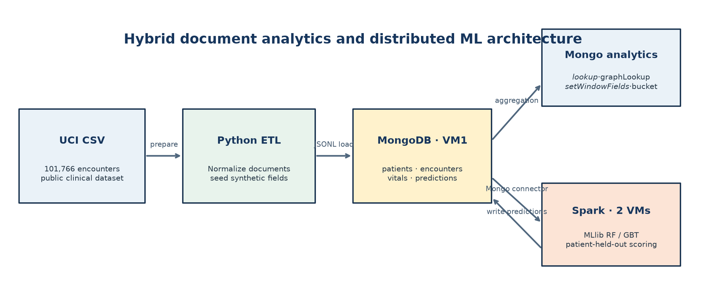
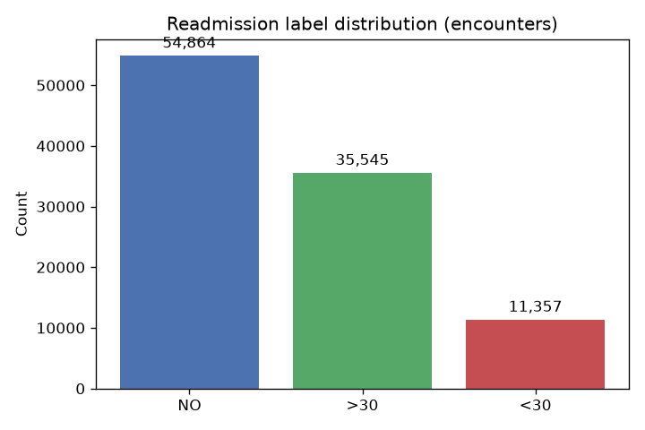
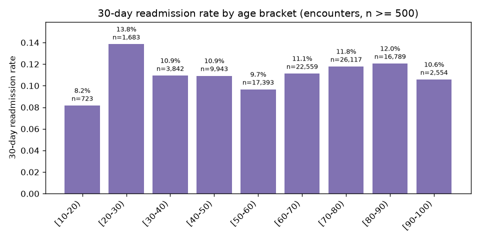
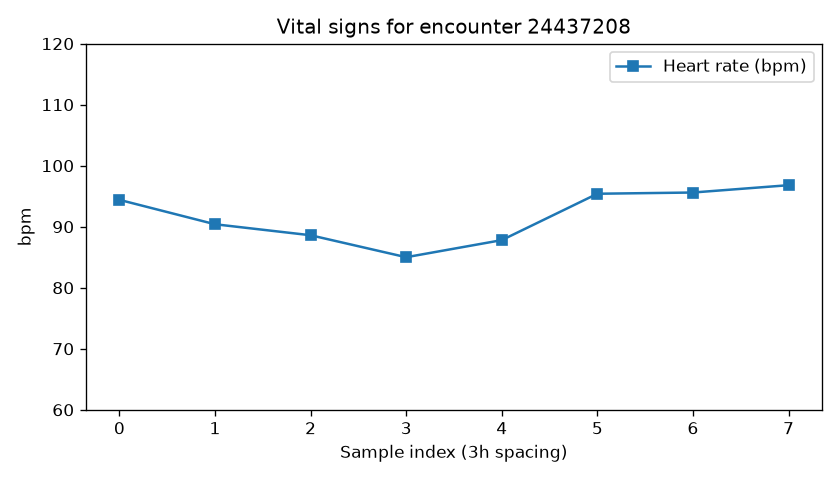
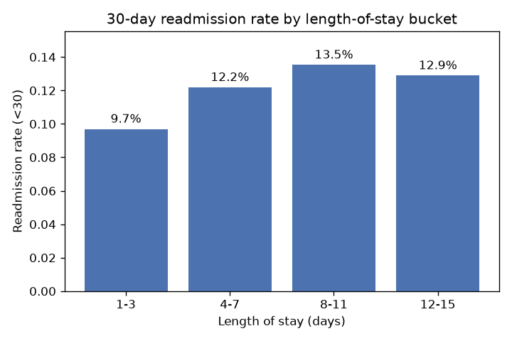
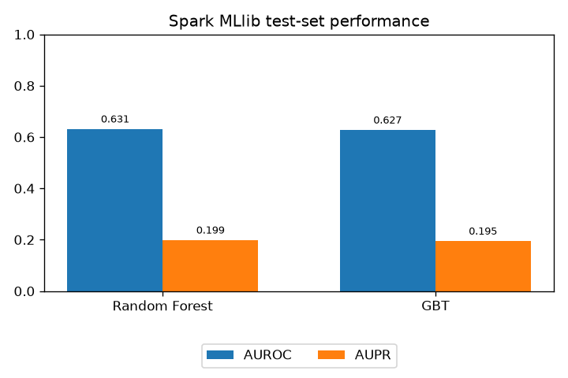

# Readmission analytics: results and limitations

## Architecture

MongoDB stores patient, encounter, vital, and prediction documents. Python prepares
and ingests the data. MongoDB aggregations demonstrate demographic joins, history
traversal, rolling windows, and length-of-stay categorization. Spark reads
encounters and patient demographics, trains classifiers, and writes held-out
predictions back to MongoDB.



The pipeline was exercised on two Linux VMs using Rocky Linux 10.2, Java 21,
Python 3.12, Spark 4.1.2 standalone, MongoDB 7.0.14, and MongoDB Spark Connector
11.1.0. One VM ran the driver, master, and MongoDB; the other ran a Spark worker.
No comparative throughput, latency, or speedup benchmark was performed.

## Data integrity

Source: [UCI Diabetes 130-US hospitals for years 1999-2008](https://archive.ics.uci.edu/dataset/296/diabetes+130-us+hospitals+for+years+1999-2008).

The loaded data contains 71,518 patients, 101,766 unique encounters, and 814,128
synthetic vital records. Every encounter joins to a patient and has exactly
eight vital records. The binary target is 1 only for `<30`.

| Source label | Encounters | Share |
|--------------|-----------:|------:|
| `NO` | 54,864 | 53.91% |
| `>30` | 35,545 | 34.93% |
| `<30` | 11,357 | 11.16% |



Demographics use the first source row for each patient. Age analyses therefore
describe encounters grouped by that patient-level age bracket, not necessarily
the age at each encounter. Missing race values are displayed as `Unknown`.

## MongoDB analytics

Run `python3 scripts/mongo_analytics.py` for summaries or use
[queries/analytics.js](../queries/analytics.js) for interactive operator examples.

### Demographic joins

| Patient race | Encounters | `<30` events | Rate |
|--------------|-----------:|-------------:|-----:|
| Caucasian | 76,043 | 8,581 | 11.28% |
| African American | 19,165 | 2,154 | 11.24% |
| Unknown | 2,367 | 204 | 8.62% |
| Hispanic | 2,063 | 217 | 10.52% |
| Other | 1,517 | 141 | 9.29% |
| Asian | 611 | 60 | 9.82% |

These unadjusted rates are descriptive, not causal or risk-adjusted comparisons.



The age chart joins patient demographics and displays brackets with at least 500
encounters. Rates are not monotonic: `[10-20)` is 8.16% (59/723), while `[20-30)`
is 13.84% (233/1,683). The omitted `[0-10)` group has 163 encounters and three
positive outcomes (1.84%).

### History and rolling windows

The first 500 encounters with a prior link, ordered by encounter ID, have mean
1.498 linked prior stays. The maximum of six is limited by `maxDepth: 5`,
not an unrestricted history maximum. Links and dates are synthetic ordering
metadata, not observed hospital chronology.

For encounter 12522, the first three synthetic heart rates are 83.5, 84.6, and
84.7 bpm. The current-and-previous-two-sample rolling means are 83.50, 84.05, and
84.27 bpm.



The series illustrates time-series storage only. Heart rate and glucose are
generated using the target label and **must not be used as predictive features**.

### Length of stay

| Bucket (days) | Encounters | `<30` events | Rate |
|---------------|-----------:|-------------:|-----:|
| 1-3 | 49,188 | 4,768 | 9.69% |
| 4-7 | 37,288 | 4,544 | 12.19% |
| 8-11 | 11,590 | 1,568 | 13.53% |
| 12-15 | 3,700 | 477 | 12.89% |



No stays of 16 or more days were present. The rate rises through 8-11 days and
then decreases. This does not establish that longer stays cause readmission.

## Patient-held-out classification

Features include encounter utilization counts and indexed gender, patient age,
A1C result, diabetes medication, and insulin. Synthetic vitals, notes, and source
labels are excluded. A deterministic patient-hash split with seed 42 prevents
patient overlap; only the training majority class is downsampled.

The training partition contains 57,078 patients. Model fitting uses 26,944
encounters from 21,437 patients after downsampling (8,994 positives and 17,950
negatives). The holdout contains 14,440 patients and 20,642 encounters: 2,363
positives and 18,279 negatives. Its positive prevalence is 11.45%.

| Model | AUROC | AUPR | Accuracy | Precision | Recall | F1 |
|-------|------:|-----:|---------:|----------:|-------:|---:|
| Random Forest (80 trees) | 0.6315 | 0.1987 | 0.8756 | 0.3294 | 0.0834 | 0.1331 |
| GBT (40 iterations) | 0.6275 | 0.1948 | 0.8524 | 0.2581 | 0.1545 | 0.1933 |
| Always-negative baseline | - | - | 0.8855 | - | 0 | 0 |



At the default 0.5 threshold:

| Model | TP | TN | FP | FN |
|-------|---:|---:|---:|---:|
| Random Forest | 197 | 17,878 | 401 | 2,166 |
| GBT | 365 | 17,230 | 1,049 | 1,998 |

Random Forest was selected by AUROC; MongoDB contains 20,642 unique predictions
with scores in `[0, 1]`. Current metrics are saved in `output/metrics.json`.

## Interpretation

Both models rank modestly above chance but have low recall and lower default-
threshold accuracy than the majority baseline. The observed AUROC difference is
small and has not been tested for statistical significance. Selection used the
holdout score, so an independent final evaluation set would be needed for an
unbiased assessment of the selected model.

The historical dataset uses ICD-9-era fields. Synthetic timelines are not suitable
for temporal validation. Probabilities are not calibrated after downsampling.
Threshold optimization, cross-validation, external testing, and clinical utility
evaluation were not performed. This pipeline is not suitable for clinical use.

## Reproducing the analysis

Follow the [runbook](../STEPS/00-prerequisites.md) with your own ignored local
configuration. Use a dedicated MongoDB database: loading drops and recreates
project collections, and training overwrites predictions.

```bash
python3 scripts/mongo_analytics.py
set -o pipefail
bash scripts/run_spark_train.sh 2>&1 | tee output/spark_train.log
python3 scripts/make_charts.py
```
