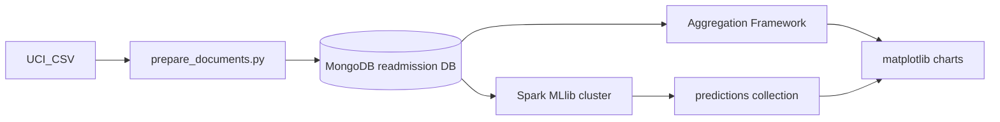
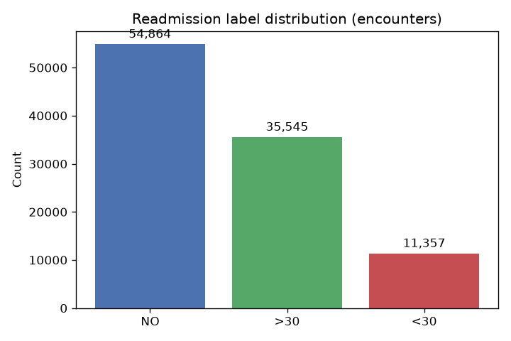
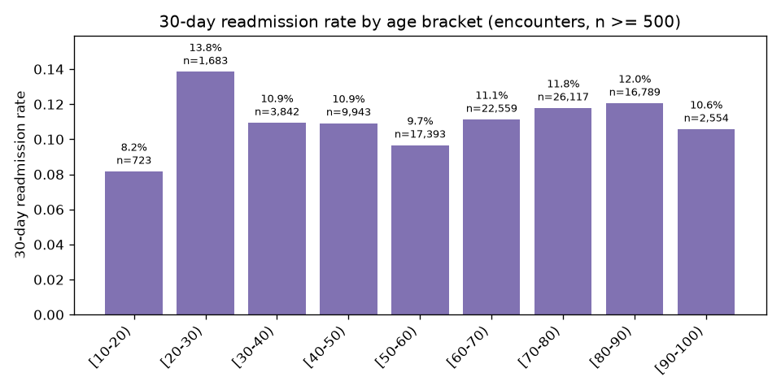
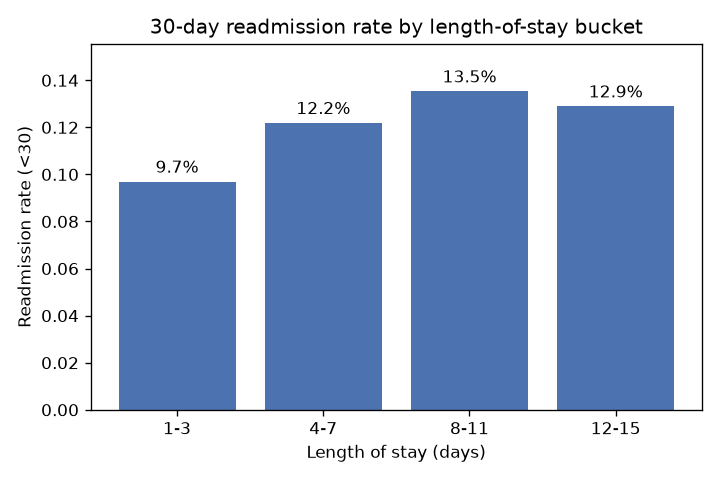
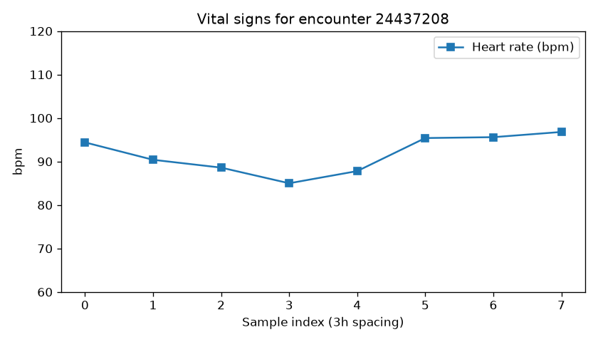
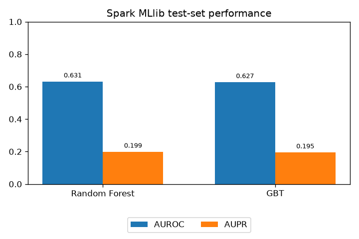

# CC ZG522 — Assignment 2  
## Big Data Systems Implementation & Analytics

**Assignment title:** Scenario 3 — Healthcare & Telemedicine (30-day readmission)  
**Track:** C — Hybrid (MongoDB + Apache Spark MLlib)  
**Platform:** Self-hosted two-VM cluster (MongoDB + Spark master on VM1, Spark worker on VM2)

---

| Field | Value |
|-------|-------|
| **Name** | Dhruv Kumar |
| **BITS ID** | 2026NS03024 |
| **Date** | 2026-11-01 |

---

## 1. Problem statement

Regional hospital networks need to combine structured encounter data, longitudinal vitals, and clinical documentation to estimate **30-day readmission risk** after discharge. The assignment compares **where compute should run**: indexed document operations close to MongoDB versus **distributed model training** on a Spark cluster when feature matrices grow beyond comfortable single-node memory.

This submission uses **Track C**: MongoDB as the operational document store and analytics engine; **PySpark MLlib** on a Spark worker for classification; predictions persisted back to MongoDB collection `predictions`.

## 2. Architecture

| Layer | Responsibility |
|-------|----------------|
| MongoDB | CRUD-shaped loads, `$lookup`, `$graphLookup`, `$setWindowFields`, `$bucket` |
| Spark | Vital aggregates at scale, join encounters + patients, RF/GBT training |
| Python (driver) | ETL to JSONL, chart export, orchestration scripts |

**Validated runtime:** Rocky Linux 10.2 on both VMs, Java 21, Spark 4.1.2 standalone, and MongoDB 7.0.14. VM1 runs the driver, Spark master, and MongoDB; VM2 runs the Spark worker. Cluster traffic uses the reachable private interface.

## 3. Data sources and enrichment

**Primary source:** UCI *Diabetes 130-US hospitals for years 1999–2008* (Strack et al., 2014). Encounter-level fields include demographics (via join), length of stay, utilization counts, ICD-9 diagnosis codes, A1C and medication fields, and readmission label (`NO`, `>30`, `<30`).

**Enrichment (synthetic, seeded):** Because the public file lacks admission timestamps, CGM-style streams, and free-text notes, this project adds:

- `admission_ts` and `prev_encounter_id` for temporal / graph analytics; these are synthetic ordering metadata, not observed hospital dates
- Eight three-hourly vital records per encounter, each with heart rate and glucose values
- Short templated `clinical_note` text for document realism (**not** used as ML features to avoid leakage)

**Important leakage control:** Synthetic heart rate and glucose values are generated using the readmission label (the `<30` class receives an upward shift). They are therefore **excluded from model features** and used only for the MongoDB time-series demonstration and chart. Including them would leak the target and inflate model metrics.

**Limitations:** ICD-9 rather than ICD-10; vitals and timestamps are simulated, not device-sourced; the positive class is sparse (~11% `<30`); and synthetic dates do not support temporal generalization claims.

## 4. MongoDB schema

Database: `readmission`

| Collection | Description |
|------------|-------------|
| `patients` | `patient_nbr`, `race`, `gender`, `age` |
| `encounters` | Nested `diagnoses[]`, `medications[]`, `clinical_note`, labels, utilization fields |
| `vitals` | `encounter_id`, `ts`, `heart_rate_bpm`, `glucose_mg_dl` |
| `predictions` | Spark output: `encounter_id`, `label`, `probability`, `prediction`, `model` |

Indexes: unique on `patient_nbr` / `encounter_id`; compound on `vitals (encounter_id, ts)`.

## 5. MongoDB analytics (Track A operators)

Implemented in [`queries/analytics.js`](../queries/analytics.js) and [`scripts/mongo_analytics.py`](../scripts/mongo_analytics.py):

1. **`$lookup`** — attach patient demographics to encounters and summarize `<30` readmissions by race. Missing race values are grouped as `Unknown` for the summary.
2. **`$graphLookup`** — walk `prev_encounter_id` to count prior stays in the same patient timeline.
3. **`$setWindowFields`** — rolling mean heart rate over the current and previous two samples within one encounter.
4. **`$bucket`** — length-of-stay buckets with `<30` readmission rate.

These aggregations were run against the loaded MongoDB collections. The patient and encounter keys used by `$lookup`/`$graphLookup` are indexed. The results below are descriptive summaries, not causal estimates.

### 5.1 Observed MongoDB results

The database contains **71,518 patients**, **101,766 unique encounters**, and **814,128 vitals**. All encounters joined to a patient, and each encounter has exactly eight vital records. The target mapping was checked against `readmitted`: all 11,357 `<30` encounters have target 1 and all `>30`/`NO` encounters have target 0.

| Readmission label | Encounters | Share |
|-------------------|-----------:|------:|
| `NO` | 54,864 | 53.91% |
| `>30` | 35,545 | 34.93% |
| `<30` (positive target) | 11,357 | 11.16% |

`$lookup` summary by patient race:

| Race | Encounters | `<30` readmissions | Rate |
|------|-----------:|-------------------:|-----:|
| Caucasian | 76,043 | 8,581 | 11.28% |
| African American | 19,165 | 2,154 | 11.24% |
| Unknown / missing | 2,367 | 204 | 8.62% |
| Hispanic | 2,063 | 217 | 10.52% |
| Other | 1,517 | 141 | 9.29% |
| Asian | 611 | 60 | 9.82% |

These are unadjusted descriptive rates; the smaller groups have limited sample sizes and should not be interpreted as demographic effects.

`$graphLookup` was run on the first 500 encounters with a prior stay, ordered by encounter ID. The mean linked prior stays was **1.498** and the maximum was **6 within the configured `maxDepth: 5` traversal** (the maximum is depth-capped, not an unrestricted patient-history maximum).

`$setWindowFields` sample: encounter **12522** has eight synthetic samples three hours apart. Its first three heart rates are 83.5, 84.6, and 84.7 bpm; the corresponding trailing-three-sample rolling means are **83.50**, **84.05**, and **84.27** bpm.

| LOS bucket (days) | Encounters | `<30` readmissions | Rate |
|-------------------|-----------:|-------------------:|-----:|
| 1–3 | 49,188 | 4,768 | 9.69% |
| 4–7 | 37,288 | 4,544 | 12.19% |
| 8–11 | 11,590 | 1,568 | 13.53% |
| 12–15 | 3,700 | 477 | 12.89% |

No stays of 16 or more days were present in this loaded dataset, so the `16+` default bucket is empty. The observed readmission rate rises through 8–11 days and is lower in the 12–15 day bucket; this is descriptive, not evidence that longer stays cause readmission.

The age chart joins encounters to patients and omits brackets with fewer than 500 encounters. Among displayed brackets, the rate ranges from 8.16% for ages `[10-20)` (723 encounters) to 13.84% for `[20-30)` (1,683 encounters); the pattern is not monotonic. The `[0-10)` bracket has 163 encounters, including three `<30` readmissions (1.84%), and is omitted by the display threshold.

## 6. Spark MLlib pipeline (Track C)

**Input:** Mongo Spark connector reads encounters and patient demographics; vitals are deliberately excluded because they encode the target by construction.
**Features:** Length of stay, lab/procedure/medication counts, prior utilization counts, number of diagnoses, and indexed gender/age/A1C/diabetesMed/insulin. The target is `label_readmit_30d`; the source label and synthetic clinical note are not features.
**Split and imbalance:** Deterministic hash split by patient (seed 42), so a patient's encounters cannot cross between train and test. The training majority class is downsampled to about 2× the positive count; test prevalence is kept natural.
**Models:** Random Forest (80 trees) and GBT (40 iterations); scores and confusion matrices are computed on the held-out patient set at the default 0.5 threshold.
**Write-back:** The model with the higher AUROC writes predictions for the held-out encounters to `predictions` (overwrite mode). These probabilities are **not calibrated** after training-set downsampling.

The earlier encounter-random-split experiment that included synthetic vitals is superseded; its metrics are not reported because the label-dependent vital generation could leak the target and repeated patients could cross the split.

### 6.1 Results

The split held out **14,440 patients / 20,642 encounters**; the training partition contained 57,078 patients. After class downsampling, the model trained on **26,944 encounters from 21,437 patients**, with 8,994 positives and 17,950 negatives. The held-out set contained 2,363 positives (11.45%) and 18,279 negatives. The majority-class-only accuracy baseline is **88.55%**.

| Model / baseline | AUROC | AUPR | Accuracy | Precision | Recall | F1 |
|------------------|------:|-----:|---------:|----------:|-------:|---:|
| Random Forest | 0.6315 | 0.1987 | 0.8756 | 0.3294 | 0.0834 | 0.1331 |
| GBT | 0.6275 | 0.1948 | 0.8524 | 0.2581 | 0.1545 | 0.1933 |
| Majority-class baseline | — | — | 0.8855 | — | 0 | 0 |

The Random Forest was selected because its AUROC was higher. Both models rank above chance (and their AUPR exceeds the 11.45% test prevalence), but their default-threshold accuracy is below the majority baseline and recall is low. These results indicate **weak predictive performance**, not a deployment-ready risk model. Threshold selection, calibration, cross-validation, and external/temporal validation were not performed.

Confusion matrices (test set):

- Random Forest: TP 197, TN 17,878, FP 401, FN 2,166
- GBT: TP 365, TN 17,230, FP 1,049, FN 1,998

The Random Forest was written back as the selected model. MongoDB contains **20,642 unique test-encounter predictions**, matching the held-out test size; the stored scores were verified to be in the `[0, 1]` range.

## 7. Visualizations

Generated by `python3 scripts/make_charts.py` from MongoDB data and `output/metrics.json`.

### 7.1 Readmission label distribution

### 7.2 Readmission rate by age

Age is joined from the patient collection. Brackets with fewer than 500 encounters are omitted; rates are descriptive, unadjusted values.

### 7.3 Readmission rate by length of stay

The axis starts at zero; only buckets with encounters are shown.

### 7.4 Synthetic sample vital series

The values are simulated and label-dependent; this chart illustrates time-series storage/windowing only and is not used as model evidence.

### 7.5 Patient-held-out model metrics

### 7.6 Cluster evidence

Cluster evidence screenshots still need to be captured and attached before submission:

1. Two-VM / Spark worker status
2. MongoDB counts or aggregation output
3. Spark job stages running on the worker

## 8. Compute placement — discussion

This implementation demonstrates MongoDB aggregation operators on collections already in the document store: `$lookup` for patient demographics, `$graphLookup` for synthetic prior-stay links, `$setWindowFields` for a per-encounter vital window, and `$bucket` for LOS summaries.

Spark joined encounters to patient demographics, engineered features, trained the two MLlib tree models on a standalone cluster, and wrote held-out predictions back to MongoDB. The worker executed distributed tasks. This assignment did not benchmark MongoDB against Spark or measure speedup, so no performance advantage is claimed. Because synthetic vitals encode the outcome and the leakage-safe model does not beat the majority accuracy baseline, the model results are a limited demonstration rather than evidence for clinical use.

## 9. Reproducibility

Follow [`STEPS/`](../STEPS/) on the **driver VM** after `git pull`. Configuration: `config.env` from discovery and optional `cluster/cluster.env`. Recreate the seeded document enrichment with `scripts/prepare_documents.py`, load MongoDB, run `scripts/mongo_analytics.py`, then run `scripts/run_spark_train.sh` and `scripts/make_charts.py`. Fixed seeds are used for synthetic data, patient split, downsampling, and model estimators.

## 10. References

1. Strack, B., DeShazo, J. P., Gennings, C., Olmo, J. L., Ventura, S., Cios, K. J., & Clore, J. N. (2014). Impact of HbA1c measurement on hospital readmission rates. *BioMed Research International*, 2014. UCI ML Repository: [Diabetes 130-US hospitals for years 1999–2008](https://archive.ics.uci.edu/dataset/296/diabetes+130-us+hospitals+for+years+1999-2008).
2. MongoDB Inc. Aggregation pipeline operators (`$lookup`, `$graphLookup`, `$setWindowFields`, `$bucket`). MongoDB Manual.  
3. Apache Spark Project. MLlib classification and evaluation (Random Forest, GBT, BinaryClassificationEvaluator). Spark Documentation.  
4. MongoDB Spark Connector — connection URI and read/write configuration. MongoDB Docs.

---

*End of report.*
