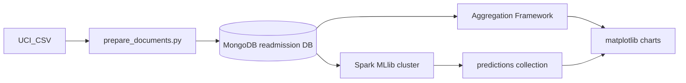

# CC ZG522 — Assignment 2  
## Big Data Systems Implementation & Analytics

**Assignment title:** Scenario 3 — Healthcare & Telemedicine (30-day readmission)  
**Track:** C — Hybrid (MongoDB + Apache Spark MLlib)  
**Platform:** BITS Prayogshala (master + slave1 + slave2)

---

| Field | Value |
|-------|-------|
| **Name** | _[Your full name]_ |
| **BITS ID** | _[Your ID]_ |
| **Date** | _[Submission date]_ |

---

## 1. Problem statement

Regional hospital networks need to combine structured encounter data, longitudinal vitals, and clinical documentation to estimate **30-day readmission risk** after discharge. The assignment compares **where compute should run**: indexed document operations close to MongoDB versus **distributed model training** on a Spark cluster when feature matrices grow beyond comfortable single-node memory.

This submission uses **Track C**: MongoDB as the operational document store and analytics engine; **PySpark MLlib** on Prayogshala workers for classification; predictions persisted back to MongoDB collection `predictions`.

## 2. Architecture

| Layer | Responsibility |
|-------|----------------|
| MongoDB | CRUD-shaped loads, `$lookup`, `$graphLookup`, `$setWindowFields`, `$bucket` |
| Spark | Vital aggregates at scale, join encounters + patients, RF/GBT training |
| Python (driver) | ETL to JSONL, chart export, orchestration scripts |

## 3. Data sources and enrichment

**Primary source:** UCI *Diabetes 130-US hospitals for years 1999–2008* (Strack et al., 2014). Encounter-level fields include demographics (via join), length of stay, utilization counts, ICD-9 diagnosis codes, A1C and medication fields, and readmission label (`NO`, `>30`, `<30`).

**Enrichment (synthetic, seeded):** Because the public file lacks admission timestamps, CGM-style streams, and free-text notes, this project adds:

- `admission_ts` and `prev_encounter_id` for temporal / graph analytics  
- Eight vital measurements per encounter (heart rate, glucose) with modest class-dependent shift  
- Short templated `clinical_note` text for document realism (**not** used as ML features to avoid leakage)

**Limitation (explicit):** ICD-9 not ICD-10; vitals are simulated, not device-sourced; positive class is sparse (~11% `<30`).

## 4. MongoDB schema

Database: `readmission`

| Collection | Description |
|------------|-------------|
| `patients` | `patient_nbr`, `race`, `gender`, `age` |
| `encounters` | Nested `diagnoses[]`, `medications[]`, `clinical_note`, labels, utilization fields |
| `vitals` | `encounter_id`, `ts`, `heart_rate_bpm`, `glucose_mg_dl` |
| `predictions` | Spark output: `encounter_id`, `label`, `probability`, `prediction`, `model` |

Indexes: unique on `patient_nbr` / `encounter_id`; compound on `vitals (encounter_id, ts)`.

## 5. MongoDB analytics (Track A operators)

Implemented in [`queries/analytics.js`](../queries/analytics.js) and [`scripts/mongo_analytics.py`](../scripts/mongo_analytics.py):

1. **`$lookup`** — attach patient race/gender/age to encounters; summarized readmission counts by race.  
2. **`$graphLookup`** — walk `prev_encounter_id` to count prior stays in the same patient timeline.  
3. **`$setWindowFields`** — rolling mean heart rate over a three-sample window within one encounter.  
4. **`$bucket`** — length-of-stay buckets with `<30` readmission rate.

These run on the master against indexed collections; results are suitable for operational dashboards without shipping full collections to Spark.

## 6. Spark MLlib pipeline (Track C)

**Input:** Mongo Spark connector reads `encounters`, `patients`, `vitals` (vitals repartitioned to utilize workers).  
**Features:** Length of stay, lab/procedure/medication counts, prior utilization counts, gender/age/A1C/insulin/diabetesMed (indexed), vital summary statistics (mean/std/min/max for HR and glucose).  
**Split:** 80/20 random split, seed 42. Training set majority class downsampled to ~2× positive count.  
**Models:** Random Forest (80 trees) and GBT (40 iterations); metrics on **held-out test** only.  
**Write-back:** Best model by AUROC writes to `predictions` (overwrite mode).

### 6.1 Results (fill after cluster run)

Copy values from `output/metrics.json` after `bash scripts/run_spark_train.sh`.

| Model | AUROC | AUPR | Accuracy | Notes |
|-------|-------|------|----------|-------|
| Random Forest | _TBD_ | _TBD_ | _TBD_ | |
| GBT | _TBD_ | _TBD_ | _TBD_ | |
| **Selected for write-back** | _TBD_ | | | _model name_ |

Confusion matrices (test set):

- Random Forest: TP _TBD_, TN _TBD_, FP _TBD_, FN _TBD_  
- GBT: TP _TBD_, TN _TBD_, FP _TBD_, FN _TBD_

## 7. Visualizations

Generated by `python3 scripts/make_charts.py` into `report/figures/`:

| Figure | File |
|--------|------|
| Label distribution | `fig1_readmission_counts.png` |
| Readmission rate by age | `fig2_readmission_by_age.png` |
| LOS vs readmission | `fig3_los_readmission.png` |
| Sample vitals series | `fig4_vitals_series.png` |
| RF vs GBT metrics | `fig5_model_metrics.png` (after Spark run) |

### 7.1 Prayogshala screenshots

_Place cluster UI, mongosh aggregation, and Spark UI / driver log screenshots here._

1. Three active nodes — _filename or image_  
2. Mongo aggregation — _filename or image_  
3. Spark job on workers — _filename or image_

## 8. Compute placement — discussion

MongoDB aggregations excel when pipelines filter early on indexes, return **small result sets**, and avoid shipping large arrays to the client. `$graphLookup` and `$setWindowFields` fit **per-patient** or **per-encounter** windows on data already colocated with the document model.

Spark was used for **pairwise joins of three collections**, **grouped vital statistics** over ~800k vital documents, and **iterative tree ensembles** where MLlib expects columnar feature vectors and benefits from cluster parallelism. Even though the UCI extract is not “big” by industry standards, repartitioning vitals and running on YARN demonstrates the **hybrid pattern**: operational store in MongoDB, heavy analytics in Spark, predictions synced back for charting or downstream apps.

## 9. Reproducibility

Follow [`STEPS/`](../STEPS/) in order on the Prayogshala **master** node after `git pull`. Configuration: `config.env` from `config.example.env` and `scripts/discover_cluster.sh`.

## 10. References

1. Strack, B., Deshazo, C., Gennings, C., Olmo, J. L., Ventura, S., Cios, K. J., & Clore, J. N. (2014). Impact of HbA1c measurement on hospital readmission rates. *BioMed Research International*, 2014. UCI ML Repository: Diabetes 130-US hospitals.  
2. MongoDB Inc. Aggregation pipeline operators (`$lookup`, `$graphLookup`, `$setWindowFields`, `$bucket`). MongoDB Manual.  
3. Apache Spark Project. MLlib classification and evaluation (Random Forest, GBT, BinaryClassificationEvaluator). Spark Documentation.  
4. MongoDB Spark Connector — connection URI and read/write configuration. MongoDB Docs.

---

*End of report.*
